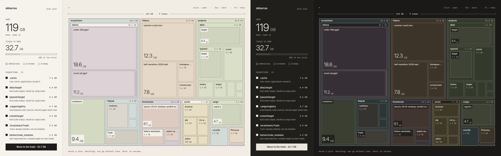

# Débarras

[](https://github.com/alarboulletmarin/debarras/actions/workflows/ci.yml)
[](https://github.com/alarboulletmarin/debarras/releases/latest)
[](LICENSE)

See what fills your disk, and free what can go. Débarras draws a folder as an architect's plan: one plot per item, sized by what it takes on disk, with hatching on what can be freed without loss. Written in Rust with [GPUI](https://www.gpui.rs), a GPU-accelerated UI framework.



**[Install](#install)** · **[User guide](book/src/introduction.md)** · [Shortcuts](book/src/shortcuts.md) · [Website](https://alarboulletmarin.github.io/debarras/) · [Contributing](CONTRIBUTING.md)

## Why Débarras

- **The whole folder at a glance.** Every item is a plot whose area is its size. Large folders open in place, three levels deep.
- **What can go is drawn.** Hatching: rebuilt or downloaded again when needed (`node_modules`, `target`, caches, the trash). Dots: large, for you to judge (disk images, AI models, containers). Each plot says why.
- **Nothing leaves your computer.** No account, no network, no telemetry. The scan reads sizes, never the content of a file.
- **Nothing is deleted behind your back.** You tick what to free and see the total before anything happens.
- **Fast.** The folders are read in parallel; hovering the plan costs a couple of milliseconds a frame. [Figures](book/src/performance.md)
- **Yours to dress.** 13 themes, light and dark, English and French.

> Version 0.1 shows and ticks; it does not delete yet. Moving the ticked items to the system's trash, after a summary, comes next.

## Install

| System | Get it |
|---|---|
| Arch Linux | the prebuilt package, below |
| macOS 11 or later | [`debarras-macos.dmg`](https://github.com/alarboulletmarin/debarras/releases/latest/download/debarras-macos.dmg) |
| Windows 10 or 11 | [installer](https://github.com/alarboulletmarin/debarras/releases/latest/download/debarras-windows-x86_64-setup.exe) or [zip](https://github.com/alarboulletmarin/debarras/releases/latest/download/debarras-windows-x86_64.zip) |
| Ubuntu, Debian, Fedora, other Linux | build from source, below |

```bash
# Arch Linux
curl -LO https://github.com/alarboulletmarin/debarras/releases/latest/download/debarras-x86_64.pkg.tar.zst
sudo pacman -U ./debarras-x86_64.pkg.tar.zst
```

```bash
# Other Linux: needs Rust 1.88 or later, and the libraries listed in the install guide
git clone https://github.com/alarboulletmarin/debarras.git
cd debarras
make && sudo make install
```

The macOS and Windows downloads are not signed. The first launch needs one extra click: see [the install guide](book/src/install.md).

## Getting started

1. Launch Débarras and click **Scan** to read your home folder, or **Choose a folder…**. `debarras ~/projects` works from a terminal, and `debarras --demo` shows a made-up disk.
2. Click a folder to open it, `Esc` or a right click to go back.
3. Click a hatched plot to tick or untick it. The panel adds up what is ticked.

More in [First steps](book/src/first-steps.md).

## Documentation

The [user guide](book/src/introduction.md) covers everything. It is also published as a website: [alarboulletmarin.github.io/debarras/guide](https://alarboulletmarin.github.io/debarras/guide/).

| Page | What it covers |
|---|---|
| [First steps](book/src/first-steps.md) | scanning a folder, moving in the plan |
| [Reading the plan](book/src/reading-the-plan.md) | plots, colours, patterns, the dimension line and the title block |
| [What can be freed](book/src/rules.md) | every rule, and why it is safe or to review |
| [Settings and appearance](book/src/settings.md) | themes, language, the files Débarras keeps |
| [Keyboard shortcuts](book/src/shortcuts.md) | every shortcut, as the help panel lists them |
| [Compatibility](book/src/compatibility.md), [Troubleshooting](book/src/troubleshooting.md), [Performance](book/src/performance.md) | systems, known problems, measurements |

## Contributing

Bug reports and small fixes are welcome. For a feature, open an issue first. Read [CONTRIBUTING.md](CONTRIBUTING.md) and the map of the code, [ARCHITECTURE.md](ARCHITECTURE.md). For a security problem, see [SECURITY.md](SECURITY.md).

## License

[MIT](LICENSE). The embedded fonts, Inter and IBM Plex Mono, are under the [SIL Open Font License](assets/fonts/).
