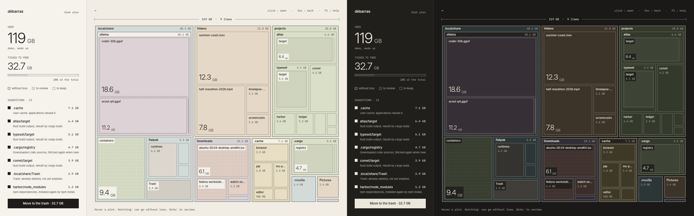

# Introduction

Débarras draws your disk as an architect's plan. Every file and folder is a plot whose area is its size, so what fills the disk is what you see first.

It also tells you what can go:

- **Hatching** marks what can be freed without loss: build output, caches, the trash. It comes back on its own, or is downloaded again, when needed.
- **Dots** mark what is large and worth a look: games, local AI models, container images, old disk images. Only you can judge those.
- Plain plots are yours. Débarras says nothing about them.

Débarras never deletes a file on its own. Ticking a plot adds it to a total, so you know what freeing it would give; then a summary lists every item, and you choose to move them to the trash or to delete them for good.

The scan stays on one disk, follows no symbolic link, and sends nothing anywhere. There is no account, no telemetry and no network access.

Next: [install Débarras](install.md), then take the [first steps](first-steps.md).
